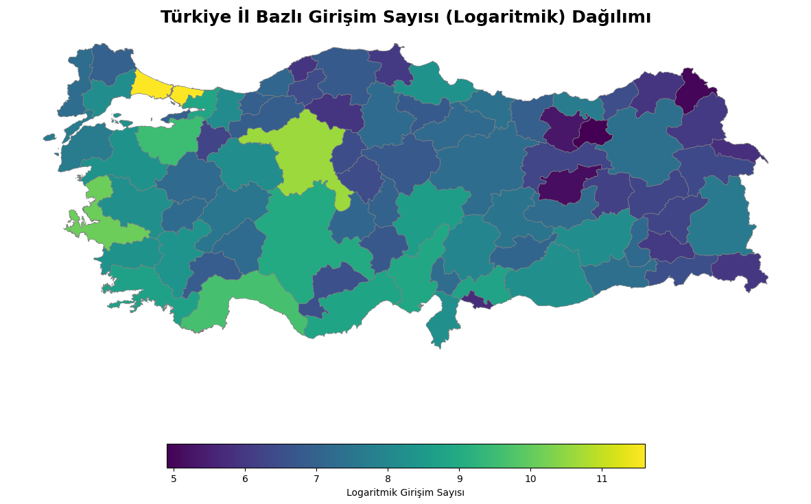
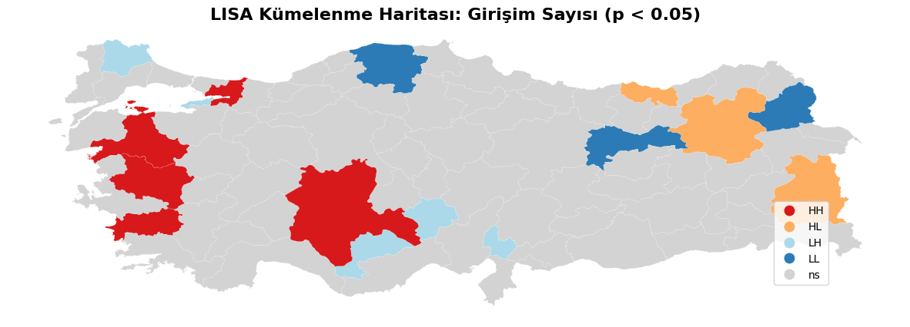
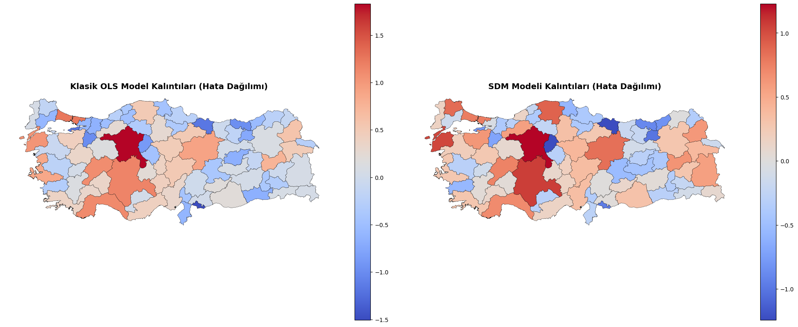

# Spatial Determinants of Entrepreneurship in Türkiye


**🇬🇧 English** · [🇹🇷 Türkçe](#-türkçe)

A province-level **spatial econometrics** study of the 81 provinces of Türkiye. It tests whether entrepreneurial activity clusters geographically and separates the **direct** effects of a province's own characteristics from **spillover** effects coming from neighbouring provinces, using a **Spatial Durbin Model (SDM)**.

<p align="center">
  
  
</p>

## Research question

How do **population density**, **urbanization rate** and **youth population share** affect the number of enterprises in professional, scientific and technical activities, both within a province and across its borders?

## Key findings

- **Significant spatial clustering:** Global Moran's I = **0.2536** (p = 0.001). Entrepreneurship is not independent of geography, so a plain OLS model is biased.
- **Model selection:** LM-WX = 17.71 (p < 0.001) and Robust LM-WX = 18.86 (p < 0.001) point to a spatial model. SDM gives the best fit:

| Model | AIC ↓ |
|---|---:|
| OLS | 152.99 |
| SAR (Spatial Lag) | 154.98 |
| SEM (Spatial Error) | 151.39 |
| **SDM (Spatial Durbin)** | **139.46** |

SDM: pseudo R² = **0.826**. The Anselin-Kelejian test (p = 0.306) shows no remaining spatial autocorrelation in the residuals.

| Variable | Direct | Indirect (spillover) | Total |
|---|---:|---:|---:|
| ln(Population density) | 0.896 | 0.210 | 1.106 |
| Urbanization rate | 0.034 | 0.008 | 0.041 |
| Youth population share | −0.007 | −0.002 | −0.009 |
| **W · ln(Population density)** (neighbours) | **−0.938** | −0.220 | **−1.158** |

> **"Shadow effect":** A province's own density and urbanization increase entrepreneurship, but **dense, attractive neighbours reduce it** (total effect −1.16). Metropolitan hubs pull talent, capital and entrepreneurs away from surrounding provinces.

<p align="center"></p>

## Methodology

1. Data preparation: TÜİK 2024 province data, log transformations, matching province names to the map.
2. Spatial weights: **Queen contiguity** matrix, row-standardized.
3. Baseline **OLS** with diagnostics: VIF, Jarque-Bera, Breusch-Pagan, Ramsey RESET.
4. Spatial dependence: Global **Moran's I**, **LISA** local clusters, LM / Robust LM tests.
5. Spatial models: **SAR, SEM, SDM, SAC/SARAR, GS2SLS** (`spreg`), compared by AIC.
6. Decomposition of **direct / indirect / total** effects and residual maps.

## Repository structure

```
├── notebooks/spatial_durbin_model.ipynb   # full analysis
├── data/
│   ├── veri.xlsx                          # TÜİK 2024 province indicators (81 provinces)
│   └── README.md                          # how to obtain the province shapefile
├── report/                                # written report (Turkish, PDF)
├── assets/                                # figures used in this README
└── requirements.txt
```

## Getting started

```bash
git clone https://github.com/4hmetcakmak/turkey-entrepreneurship-spatial-analysis.git
cd turkey-entrepreneurship-spatial-analysis
pip install -r requirements.txt
# put the province shapefile in data/ (see data/README.md)
jupyter notebook notebooks/spatial_durbin_model.ipynb
```

## Data sources

- **TÜİK** (Turkish Statistical Institute), regional statistics 2024: number of enterprises, population density, urbanization rate, youth population share.
- **Province boundaries:** OCHA / HDX *Türkiye – Subnational Administrative Boundaries* (`tur_admin1`).

---

## 🇹🇷 Türkçe

Türkiye'nin 81 ili için **mekansal ekonometri** çalışması. Girişimcilik faaliyetlerinin coğrafi olarak kümelenip kümelenmediğini test eder ve **Mekansal Durbin Modeli (SDM)** ile bir ilin kendi özelliklerinden gelen **doğrudan** etkileri, komşu illerden gelen **dolaylı (yayılma)** etkilerden ayırır.

### Temel bulgular

- **Mekansal kümelenme var:** Global Moran's I = **0,2536** (p = 0,001).
- LM testleri mekansal model gerektiğini gösterdi. **SDM en düşük AIC (139,46)** ve **0,826 pseudo R²** ile en iyi model oldu. Kalıntılarda mekansal bağımlılık kalmadı (Anselin-Kelejian p = 0,306).
- **Gölgeleme etkisi:** Bir ilin kendi nüfus yoğunluğu girişimciliği artırırken (doğrudan etki 0,90), **komşu illerin yoğunluğu azaltıyor** (toplam etki −1,16). Metropoller, çevre illerin nitelikli işgücünü, sermayesini ve girişimcilerini kendine çekiyor.

### Yöntem

TÜİK 2024 il verileri → log dönüşümleri → **Queen komşuluk** matrisi → OLS ve tanısal testler (VIF, Jarque-Bera, Breusch-Pagan, RESET) → Moran's I ve **LISA** → LM testleri → **SAR, SEM, SDM, SAC, GS2SLS** → AIC ile model seçimi → doğrudan/dolaylı/toplam etki ayrıştırması.

Ayrıntılı rapor `report/` klasöründedir.

---

**Author / Yazar:** Ahmet Çakmak · [GitHub](https://github.com/4hmetcakmak)
